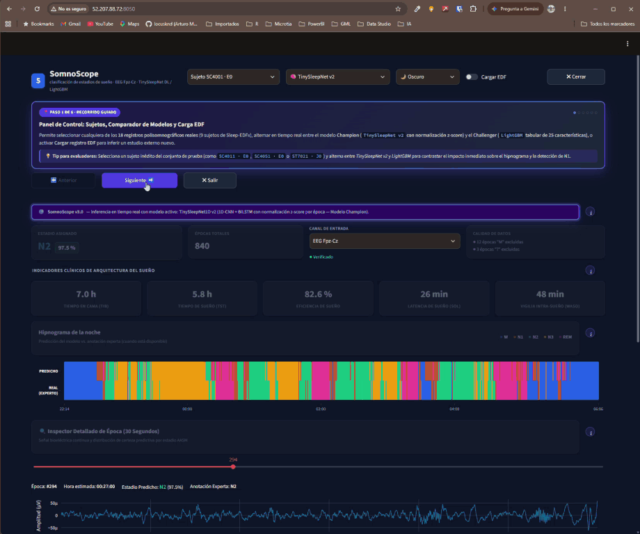

# SomnoScope — Clasificación Automática de Estadios del Sueño sobre EEG Monocanal

**Proyecto:** SomnoScope (Maestría en Inteligencia Artificial — MAIA, Universidad de los Andes)  
**Integrantes:** Arturo Molina · Catalina García · Daniel Franco · Nicolás Gómez · Luis Celedón

---

## 1. Descripción del proyecto

**SomnoScope** es una plataforma integral de Machine Learning y **MLOps** para la estadificación automática de estudios de polisomnografía (PSG) sobre un único canal de electroencefalografía, clasificando cada época de 30 segundos en los cinco estadios clínicos definidos por la Academia Americana de Medicina del Sueño (**AASM**): **Vigilia (`W`), `N1`, `N2`, `N3` y `REM`**.

El sistema combina dos paradigmas complementarios evaluados bajo **Validación Cruzada estricta por sujeto (`3-Fold GroupKFold`, 0% fuga de datos)** sobre **23 sujetos únicos de Sleep-EDF Expanded (45 noches, 48,378 épocas)**:

- **Modelo Champion (Deep Learning):** `TinySleepNet1D v2` (1D-CNN + BiLSTM en PyTorch con normalización Z-score por época y pesos inversos por clase en `CrossEntropyLoss`). Ganador en **3/3 folds** en F1-Macro y F1-N1, con peso en disco de apenas **0.62 MB** y latencia de **1.65 s por noche completa (1,000 épocas)** en CPU.
- **Modelo Challenger (ML Clásico):** `LightGBM` entrenado sobre 25 características espectrales (Welch PSD) y temporales (parámetros de Hjorth) con `class_weight="balanced"`.

### Resumen de resultados (`3-Fold GroupKFold` — 23 sujetos / 48,378 épocas)

| Modelo | Accuracy (Media ± DE) | F1-Macro (Media ± DE) | Kappa (Media ± DE) | F1-N1 | F1-REM | Latencia CPU (1 ép. / 1,000 ép.) | Peso |
| :--- | :---: | :---: | :---: | :---: | :---: | :---: | :---: |
| Random Forest v1 | 76.02 ± 3.80% | 0.6812 ± 0.0403 | 0.6737 ± 0.0554 | 0.2844 | 0.6853 | 71.8 ms / 4.02 s | 23.51 MB |
| LightGBM v1 (Base) | 76.13 ± 4.15% | 0.6942 ± 0.0426 | 0.6781 ± 0.0596 | 0.3233 | 0.6868 | 10.9 ms / 4.00 s | ~4.9 MB |
| LightGBM v2 (Challenger) | 76.02 ± 4.19% | 0.6924 ± 0.0429 | 0.6767 ± 0.0601 | 0.3163 | 0.6855 | 12.3 ms / 4.08 s | 4.94 MB |
| **TinySleepNet v2 (Champion)** | **76.27 ± 5.21%** | **0.7164 ± 0.0507** | **0.6870 ± 0.0695** | **0.3779** | **0.7638** | **9.5 ms / 1.65 s** | **0.62 MB** |

---

## 2. Enlaces relevantes

- **Repositorio GitHub:** https://github.com/Nicolasdgg/MicroP1MAIA
- **Aplicación Web Desplegada (Dashboard Clínico Streamlit — AWS EC2):** `http://52.207.88.72:8050`
- **API REST & Documentación OpenAPI (Swagger UI — FastAPI):** `http://52.207.88.72:8000/docs`
- **Healthcheck API:** `http://52.207.88.72:8000/health`
- **Servidor de Experimentos y Model Registry (MLflow):** `http://52.207.88.72:5000`
- **Dataset Público:** [PhysioNet Sleep-EDF Database Expanded](https://physionet.org/content/sleep-edfx/1.0.0/)

> **Nota sobre AWS Academy:** La aplicación productiva corre sobre una instancia AWS EC2 `t2.medium` con Elastic IP fija (`52.207.88.72`). Si el laboratorio académico temporal de 4 horas se encuentra pausado, el equipo reactiva la sesión con un clic y los tres servicios Docker levantan automáticamente.

---

## 3. Estructura del repositorio

```text
MicroP1MAIA/
├── Modelos/                    # [Obligatoria] Pesos finales serializados (.pt y .pkl)
│   ├── model_tinysleepnet.pt   # Champion: TinySleepNet1D v2 (PyTorch, 0.62 MB)
│   ├── best_sleep_model.pkl    # Challenger productivo: LightGBM (4.94 MB)
│   ├── model_lightgbm.pkl      # LightGBM entrenado en 23 sujetos
│   └── model_random_forest.pkl # Random Forest entrenado en 23 sujetos
├── Notebooks/                  # [Obligatoria] Cuadernos Jupyter (.ipynb) de entrenamiento, CV y MLflow
│   ├── run_experiments_pipeline.ipynb
│   ├── train_and_register_v2_models.ipynb
│   ├── train_full_benchmark.ipynb
│   ├── run_groupkfold_cv_23subjects.ipynb
│   ├── register_cv_mlflow.ipynb
│   └── ...
├── Datos/                      # [Obligatoria] Muestras ligeras, metadatos y esquema del dataset
│   ├── README.md
│   ├── metadatos_sujetos.csv
│   └── muestra_caracteristicas_30_epocas.csv
├── app/                        # Servicios productivos
│   ├── api.py                  # API REST v3.0 (FastAPI)
│   └── dashboard.py            # Tablero clínico interactivo v3.0 (Streamlit + Plotly)
├── src/                        # Paquete modular de procesamiento, features y modelos
│   ├── data/loader.py          # Lectura .edf (MNE), filtro 0.5-35 Hz, mapeo AASM y recorte ±30 min
│   ├── features/spectral.py    # Extracción de 25 características Welch PSD + Hjorth
│   └── models/                 # TinySleepNet1D (z-score), LightGBM/RF y evaluación clínica
├── scripts/                    # Scripts Python CLI equivalentes a los cuadernos en Notebooks/
├── tests/                      # Pruebas automatizadas Pytest (8/8 pruebas API y pipeline)
├── reports/                    # Tablas CSV/JSON de CV y figuras científicas (300 DPI)
├── Dockerfile                  # Imagen unificada optimizada con PyTorch CPU
├── docker-compose.yml          # Orquestación de 3 servicios: api, dashboard y mlflow
├── .env.example                # Plantilla de variables de entorno y parametrización
├── requirements.txt            # Dependencias Python exactas
└── README.md                   # Esta guía de despliegue y uso
```

---

## 4. Entorno de ejecución y dependencias

### Entorno de ejecución
- **Lenguaje:** Python `3.12` (compatible con `3.11+`).
- **Sistema operativo:** Linux (Ubuntu 22.04 LTS en AWS EC2 `t2.medium`, 2 vCPU, 4 GB RAM + 2 GB Swap) o Windows/macOS para desarrollo local.
- **Contenerización:** Docker `24+` y Docker Compose `v2+`.
- **Hardware:** Ejecución 100% compatible con **CPU** (no requiere GPU para inferencia ni despliegue).

### Dependencias principales (`requirements.txt` + PyTorch CPU)
- **Procesamiento biomédico y científico:** `mne>=1.5.0`, `numpy>=1.24.0`, `scipy>=1.10.0`, `pandas>=2.0.0`.
- **Machine Learning y Deep Learning:** `torch` (CPU wheel), `scikit-learn>=1.3.0`, `lightgbm>=4.0.0`, `joblib>=1.3.0`.
- **MLOps, API y Visualización:** `fastapi>=0.100.0`, `uvicorn>=0.23.0`, `streamlit>=1.30.0`, `plotly>=5.18.0`, `mlflow>=2.10.0`, `matplotlib>=3.7.0`, `seaborn>=0.12.0`.
- **Pruebas:** `pytest>=7.4.0`, `httpx>=0.25.0`.

---

## 5. Parametrización y credenciales de ejemplo

La aplicación permite ajustar rutas de modelos, puertos y URLs de servicios mediante variables de entorno definidas en `.env` (partiendo de `.env.example`) o directamente en `docker-compose.yml`:

| Variable de entorno | Valor por defecto | Descripción |
| :--- | :--- | :--- |
| `MODELS_DIR` | `./Modelos` (`/app/Modelos` en Docker) | Carpeta de carga de artefactos `.pt` y `.pkl`. |
| `DL_MODEL_FILE` | `model_tinysleepnet.pt` | Nombre del archivo de pesos del modelo Champion Deep Learning. |
| `CLASSICAL_MODEL_FILE` | `best_sleep_model.pkl` | Nombre del archivo serializado del modelo Challenger LightGBM. |
| `API_PORT` | `8000` | Puerto expuesto para el servicio REST FastAPI. |
| `DASHBOARD_PORT` | `8050` | Puerto expuesto para el tablero clínico Streamlit. |
| `API_URL` | `http://api:8000` (Docker) / `http://localhost:8000` | URL base de la API consumida por el cliente/dashboard. |
| `MLFLOW_TRACKING_URI` | `http://mlflow:5000` (Docker) / `http://localhost:5000` | URI del servidor de seguimiento y Model Registry MLflow. |

### Credenciales de acceso AWS
- **Acceso a la aplicación (Dashboard, API y MLflow):** **No requiere usuario ni contraseña** para facilitar la evaluación directa de tutores y usuarios clínicos en la demo.
- **Sincronización opcional de datos crudos vía DVC / Amazon S3:** Solo si se desea ejecutar `dvc pull` para descargar grabaciones `.edf` privadas, copiar `.env.example` a `.env` y sustituir los valores ficticios:
  ```env
  AWS_ACCESS_KEY_ID=AKIAEXAMPLEKEY123456
  AWS_SECRET_ACCESS_KEY=wJalrXUtnFEMI/K7MDENG/bPxRfiCYEXAMPLEKEY
  AWS_DEFAULT_REGION=us-east-1
  ```

---

## 6. Pasos de instalación y despliegue

### Opción A: Despliegue completo con Docker Compose (Recomendado — Local o AWS EC2)

1. **Clonar el repositorio y preparar variables de entorno:**
   ```bash
   git clone https://github.com/Nicolasdgg/MicroP1MAIA.git
   cd MicroP1MAIA
   cp .env.example .env
   ```
2. **Construir y levantar los 3 microservicios (`api`, `dashboard`, `mlflow`):**
   ```bash
   docker compose up -d --build
   ```
3. **Verificar que los servicios estén activos:**
   ```bash
   docker ps
   curl http://localhost:8000/health
   ```
4. **Registrar corridas de validación cruzada 3-Fold y versiones en MLflow (opcional si se inicia volumen limpio):**
   ```bash
   docker exec -e MLFLOW_TRACKING_URI=http://mlflow:5000 somnoscope-api python3 /app/scripts/register_cv_mlflow.py
   ```
5. **Abrir en el navegador:**
   - Dashboard SomnoScope: `http://localhost:8050` (o `http://52.207.88.72:8050` en AWS EC2)
   - Documentación Swagger API: `http://localhost:8000/docs`
   - MLflow UI: `http://localhost:5000`

### Opción B: Ejecución local sin Docker (Entorno virtual Python)

```bash
python -m venv .venv
# Linux/macOS: source .venv/bin/activate  |  Windows PowerShell: .\.venv\Scripts\Activate.ps1
pip install torch --index-url https://download.pytorch.org/whl/cpu
pip install -r requirements.txt

# Terminal 1 — API FastAPI
uvicorn app.api:app --host 0.0.0.0 --port 8000

# Terminal 2 — Tablero Streamlit
streamlit run app/dashboard.py --server.port 8050

# Terminal 3 — Pruebas unitarias automatizadas
pytest tests -v
```

---

## 7. Instrucciones básicas y ejemplos de uso

### Uso desde el Dashboard (`:8050`)
1. Ingresa a `http://52.207.88.72:8050` (o `http://localhost:8050`).
2. Opcionalmente, pulsa **"Iniciar recorrido guiado"** en la barra superior para recorrer los 6 módulos del tablero.
3. En el panel superior puedes:
   - Seleccionar un estudio real precargado (`Sleep Cassette` o `Sleep Telemetry`).
   - Alternar en vivo entre el modelo **Champion (`TinySleepNet v2`)** y el **Challenger (`LightGBM`)**.
   - Pulsar **"Cargar registro EDF"** para subir cualquier archivo polisomnográfico `.edf` nuevo y generar automáticamente el hipnograma nocturno, los KPIs (`TIB`, `TST`, Eficiencia %, `SOL`, `WASO`), el inspector de onda EEG por época y la distribución de probabilidades AASM.

#### Demostración interactiva de SomnoScope



### Ejemplos de uso de la API REST (`:8000`)

**1. Verificar estado de la API y modelos cargados (`GET /health`):**
```bash
curl -s http://localhost:8000/health
```
*Respuesta esperada:*
```json
{
  "status": "healthy",
  "champion_model": "TinySleepNet1D (PyTorch)",
  "classical_model": "LightGBM (25 features)",
  "dl_model_loaded": true,
  "classical_model_loaded": true
}
```

**2. Clasificar una época a partir de 25 características espectrales (`POST /predict/features`):**
```bash
curl -X POST http://localhost:8000/predict/features \
  -H "Content-Type: application/json" \
  -d '{"features": [0.15, 0.22, 0.18, 0.09, 0.06, 0.30, 0.25, 0.20, 0.15, 0.10, 1.5, 0.8, 0.7, 0.9, 1.2, 0.02, 0.45, 1.10, 0.01, 0.05, 0.0, 0.1, 3.0, 0.002, 0.08]}'
```

**3. Clasificar una señal cruda de 30 s (`3,000` muestras a 100 Hz) con TinySleepNet Champion (`POST /predict/epoch`):**
```python
import numpy as np, requests

signal_30s = np.random.normal(0, 1e-5, size=3000).tolist()
resp = requests.post(
    "http://localhost:8000/predict/epoch",
    json={"signal": signal_30s, "sfreq": 100.0, "model_type": "tinysleepnet"},
)
print(resp.json())
# {'stage': 'N2', 'stage_id': 2, 'confidence': 0.84, 'probabilities': {...}, 'model_used': 'TinySleepNet1D (Champion)'}
```

**4. Clasificar un archivo `.edf` completo (`POST /predict/recording`):**
```bash
curl -X POST http://localhost:8000/predict/recording \
  -F "file=@SC4001E0-PSG.edf" \
  -F "model_type=tinysleepnet"
```

---
